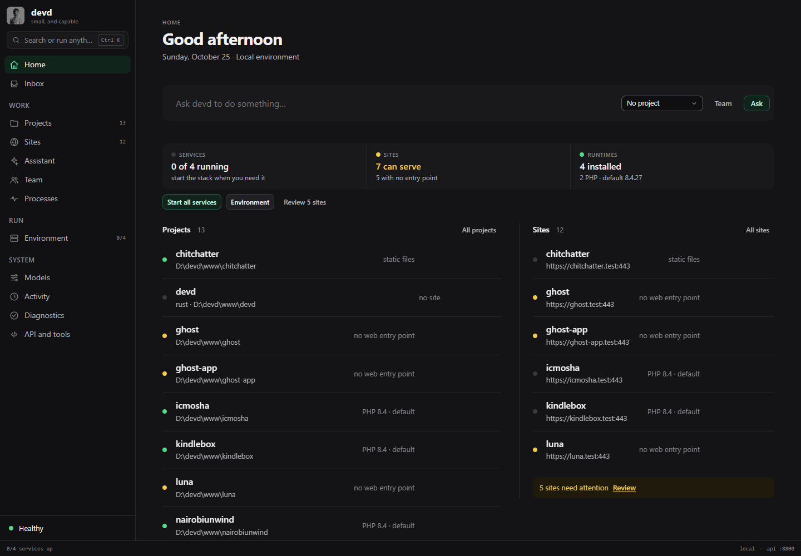
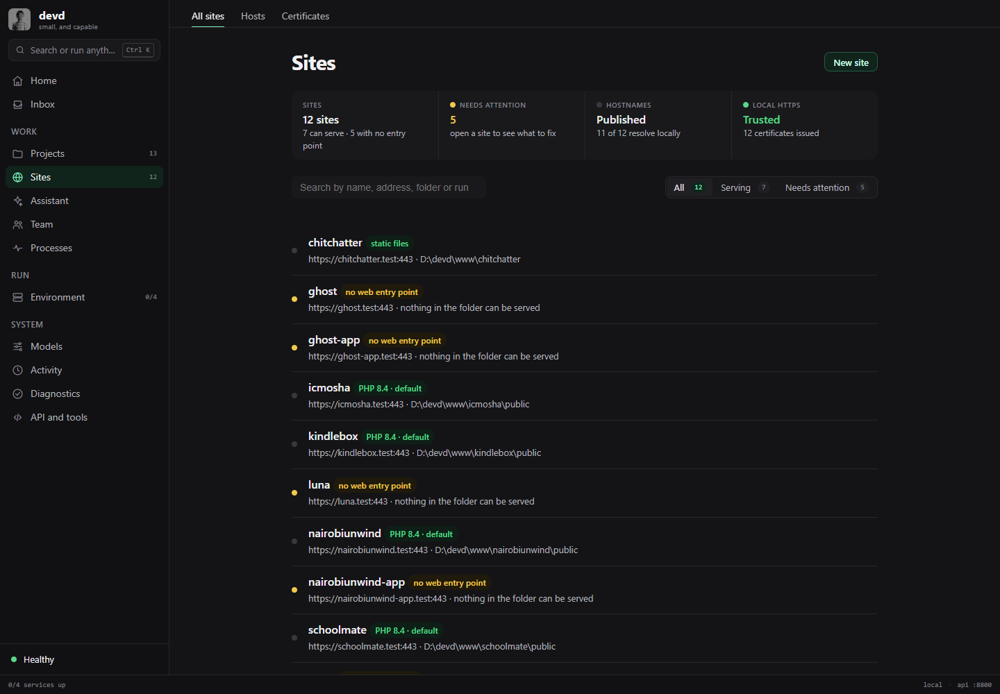
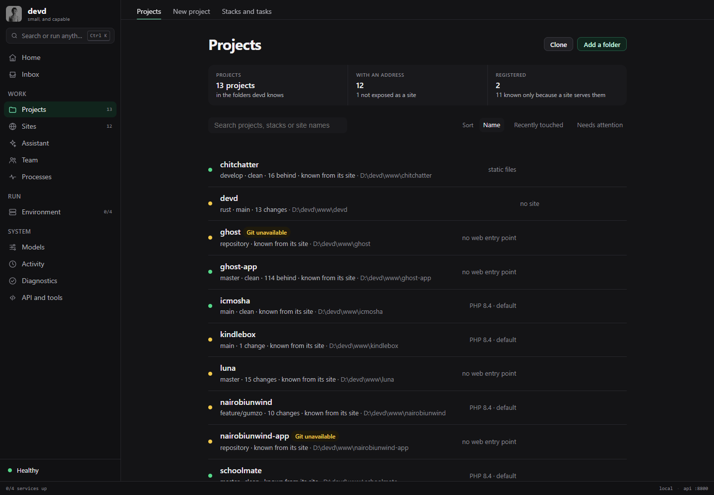
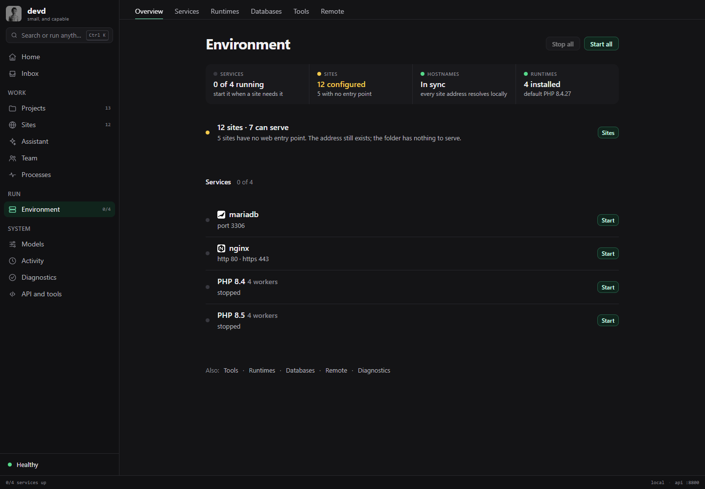
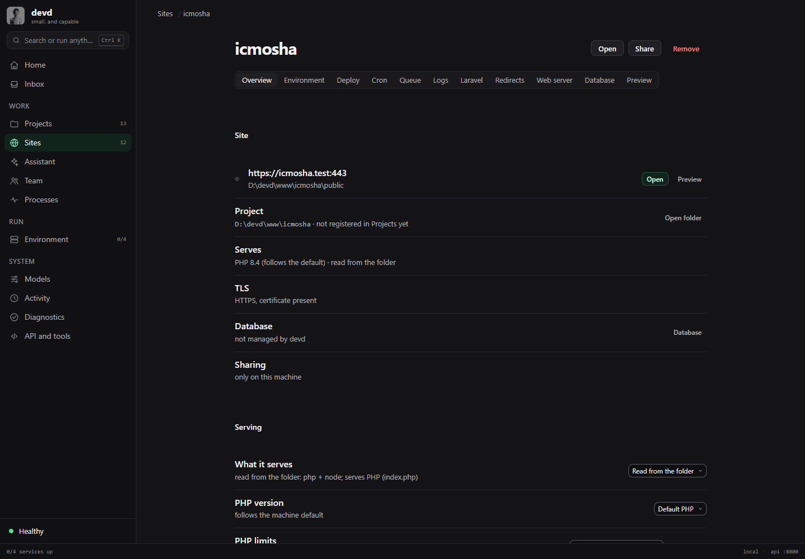
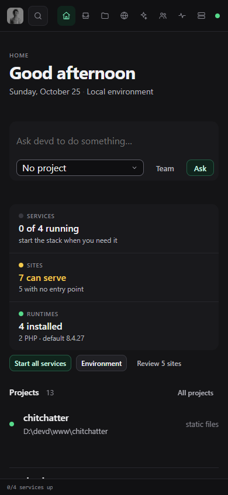

# The devd interface: a project workspace, with the environment in view

This is the design record for the application window: what was audited, the three
directions considered, the direction chosen, and the rules the interface now
follows. The capabilities and their authority are described in
[`domain.md`](domain.md) and [`security.md`](security.md); this document is about
how a person sees and uses them.

## What the interface has to answer

devd has four nouns, and the window is the only place a person can see how they
relate:

| Noun | The person's question |
| --- | --- |
| Project | What code am I building? |
| Site | At what address is it reachable, and what is actually serving it? |
| Runtime | Which interpreter will run it? |
| Service | What infrastructure has to be running for it to work? |

The audit found a competent list of those objects, but a person had to assemble
the answer from separate screens. Home showed projects and little else; Sites
was a tab inside the server console; a site's PHP version could be read without
knowing whether the site served PHP. It also found practical defects: projects
could paint "No projects yet" before their list arrived, the health chip could
sit on "Checking" for the full probe, and double-encoded punctuation was visible
in the window.

## The audit, in brief

Every route was opened against real local state: 13 projects, 12 sites, 2 PHP
runtimes, 4 installed services (all stopped), a configured model provider, and
one hostname file with a pending entry. The same routes were checked at 1440,
1040, 760 and 390 pixels wide.

| Screen | What it is for | What needed to change |
| --- | --- | --- |
| Home | Return to work and see what needs a person | Projects only. No site reachability, service state or runtime summary. |
| Projects | Find a codebase, open it, inspect its Git state | No loading/empty distinction; no site or runtime context in a row; a Git error disappeared into the console. |
| Sites | Understand access addresses and serving | Buried under Server; no summary of sites that cannot serve; repeated status text. |
| Site detail | Configure one site | The project relation was readable but not actionable. |
| Environment | Operate the stack | Sites and services in one column; "Server" is the wrong name for the whole environment. |
| Services | Start, stop and diagnose processes | Stopped was painted as a warning, and the stack was not separated from optional tools. |
| Runtimes | See versions, defaults and pins | Installed versions did not say which sites use them. |
| Assistant / Team / Activity / Diagnostics / API | Delegate, inspect, repair | Structurally sound; retained and brought into the same navigation model. |
| Create / Develop / Models / MCP / Scheduling | Setup and configuration | Structurally sound; retained. |

The audit covered loading, empty, error, degraded and long-running states. The
folders `ghost` and `nairobiunwind-app` are Git repositories owned by another
Windows account, so `git.status` refuses them. The redesign names that
condition on the row instead of hiding it or pretending the folder has no
changes. The database screen now explains a stopped MariaDB rather than showing
a raw `mysql` connection error.

## Three directions

### A. The calm desktop workspace

**Thesis.** devd should disappear into a quiet desktop routine: a rail, search,
lists, and detail only when asked for.

**Strengths.** Fast to learn, low visual noise, excellent for daily use.
**Weaknesses.** It hides the project-to-address relationship and makes an
unhealthy service look like just another row.
**Fit.** Right for the shell and routine lists; insufficient as the whole model.

### B. The local operations console

**Thesis.** devd is an instrument. Show configured versus observed state,
service dependencies, ports, certificates and diagnostics at all times.

**Strengths.** Truthful, precise, excellent when something fails.
**Weaknesses.** A local development tool is not a cloud control plane. A wall of
metrics makes "open a project, copy its URL" slower and invents monitoring
theatre around four processes.
**Fit.** Right about state honesty; wrong about default density.

### C. The project-centred development hub

**Thesis.** Developers think in projects. Sites, runtimes and services are
context around the work, not separate destinations.

**Strengths.** Matches the mental model and shortens the common workflow.
**Weaknesses.** If taken literally, global state disappears. A stopped
database, a bad certificate or a pending hostname is not owned by one project.
**Fit.** Right about the primary axis; needs a visible environment layer.

## The decision: the workbench

The chosen direction is **C with B's truth layer and A's restraint**, called the
workbench.

* **Projects are the primary axis.** Home, Projects and Site detail all lead
  back to the folder, its runtime and its address.
* **Sites are a first-class destination.** A site is the answer to "how do I
  reach this?", so it is not a tab inside a server console.
* **The environment is always in view.** Home carries a compact environment
  ledger, and the rail always exposes Environment, Activity and Diagnostics.
* **Truth before comfort.** A site with no entry point says so; PHP is shown
  only where PHP is effective; a pin that does nothing is named as unused.
  Stopped is a state, not automatically a warning. "Running" is only shown after
  a service answers.
* **Restraint in the surface.** Graphite surfaces, one mint signal, borders
  instead of shadows, type instead of boxes, and colour only for state.

The emotional target is *quiet confidence*: a well-made tool that already knows
the state of the machine, not a dashboard asking to be admired.

## Information architecture

```
Home
  environment ledger, attention, projects, sites, recent work
Projects
  all projects, new project, stacks and tasks
  project detail: changes, history, branches, reviews, memory
Sites
  all sites, hosts, certificates
  site detail: overview, environment, deploy, logs, web server, preview
Environment
  overview, services, runtimes, databases, tools, remote
Assistant
Team
  runs, schedules, skills, notes, MCP
Activity
Diagnostics
API and tools
```

The rail keeps three groups because they answer different questions: *what am I
building* (Work), *what is running* (Run), and *what is the record* (System).
Sites sits beside Projects because it is the access layer of the work.

## The system

### Type

The system UI face is used for prose, a monospaced face for paths, IDs, logs and
machine output. Five sizes carry the hierarchy: 30px page title, 16px row title
or section lead, 14px body, 13px supporting text, 12px labels. Density comes
from leading and the 4px spacing scale, not from shrinking the body copy.

### Colour

Graphite runs from `#141416` through `#202024`. Text is `#f1f1f3` primary,
`#b2b2ba` secondary and `#878790` tertiary, all above 4.5:1 on their surfaces.
Mint (`#7cf5c0`) is the single action signal. Status is semantic and is always
paired with a word, a dot or a shape: success, warning, danger, information and
neutral are never colour alone.

### Shape and motion

Radii are 4, 6, 8 and 12px. Borders separate; shadows belong only to dialogs,
drawers and toasts. Motion is 110–240ms, ease-out for entry, ease-in-out for
on-screen movement, and is removed for `prefers-reduced-motion`. Buttons scale
to 0.97 on press. Popovers scale from their trigger; dialogs stay centred. There
are no gradients, glows, glass panels or decorative status badges.

### Components

The canonical components live in `app.js` and are styled once in `style.css`:

* `page()` and `page-head` for framing; tabs only where an area has peers.
* `uiRow()` for a resource: state dot, title, one supporting line, one trailing
  fact, actions on hover (always visible on touch).
* `summaryBand()` for a small set of environment facts. It is one surface with
  labels, not a grid of dashboard cards.
* `panel` for a genuinely bounded group, never a box around one row.
* `pill` for a state word, `uiDot` for a state mark, `notice` for an explanation.
* `uiEmpty()` for an empty list, including the action that resolves it.
* `drawer` for detail that should not lose the list's context.
* `modal` for consequential decisions, with the plan and its effect spelled out.
* `toast` for a completed operation, never as the only record of a failure.

## Screen decisions

* **Home** is a two-column workbench on wide windows. The environment ledger
  (services, sites, runtimes) is full width; projects and their addresses sit
  side by side beneath it. On narrow windows it is one column in reading order.
  The assistant prompt is present but not the page's only purpose.
* **Projects** separates registered projects from folders known only because a
  site serves them, and shows the serving mode and Git state in each row. The
  loading, error and empty states are distinct.
* **Sites** leads with a status ledger (sites, attention, hostnames, local
  HTTPS), then a searchable, filterable list. Serving mode is a pill; the
  effective runtime is stated only where it exists; the right column carries
  only exceptional facts (not in hosts, no certificate).
* **Environment** keeps services and runtimes, names the stack separately from
  optional tools, and gives sites a compact link rather than duplicating the
  Sites list.
* **Runtimes** names the default, the installed path and how many sites use each
  version. A default version not used by a site is allowed to say so.
* **Databases** explains a stopped MariaDB and offers to start it, instead of
  printing a command failure to an ordinary reader.
* **Assistant, Team, Activity, Diagnostics, Models, MCP, Create and Develop**
  keep their structure because they already follow the system. They are
  retained deliberately, not left behind.

## The result

Home puts the environment ledger above the work, then projects and their sites
side by side. The screenshot is from the embedded UI at 1440px.



Sites is a first-class destination with a truth summary, filters and only
exceptional facts on the right of each row.



Projects names its three states — registered, known from a site, and not
readable by Git — without hiding any of them.



The Environment screen keeps the stack in one place; Sites has its own compact
entry instead of being duplicated here.



A site detail carries its address, project, effective runtime, TLS state and
the rest of its operation tabs.



At 390px the rail becomes a top strip, the environment ledger becomes one
column, and the project and buttons move below the prompt.



## Evidence

The redesigned routes were exercised through the real server, not a static mock.
The audit harness opens every route with a real session token, records failed
capabilities, writes screenshots, checks the 390/760/1040/1440 widths for
horizontal overflow, and runs axe-core against WCAG 2.0/2.1 A and AA on Home,
Sites, Projects, Environment, Services and Site detail. `cargo test -p
devd-server` covers the UI contract: every destination has a page, every action
has a handler, app.js parses, the logo is the same asset, and the embedded text
is UTF-8 rather than double-encoded.

## Known limits

This record covers the application window, which is the product's primary
graphical surface. The terminal dashboard and the CLI were audited at the level
of their shared capabilities and copy, but were not visually redesigned here.

The folder picker's native path depends on the desktop shell and cannot be
exercised in a plain browser. Long operations still report their real stage text
from the capability result rather than a byte-perfect progress feed; the
interface never invents a percent. Remote servers, Ploi and a running MariaDB
can only be verified to their empty or stopped states on this machine. The Git
repositories owned by another Windows account expose an operating-system
permission problem that the UI can explain but cannot repair.
